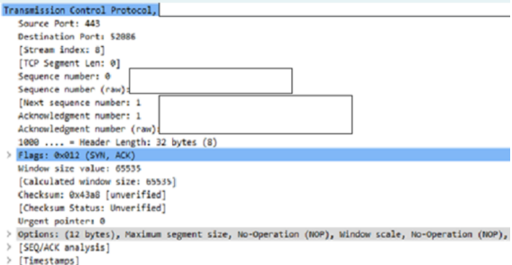
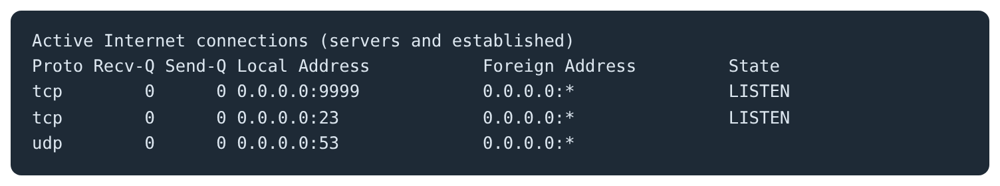
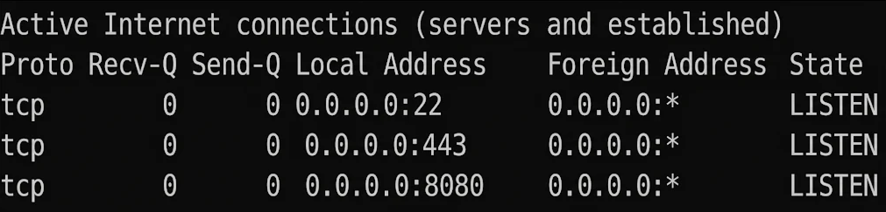
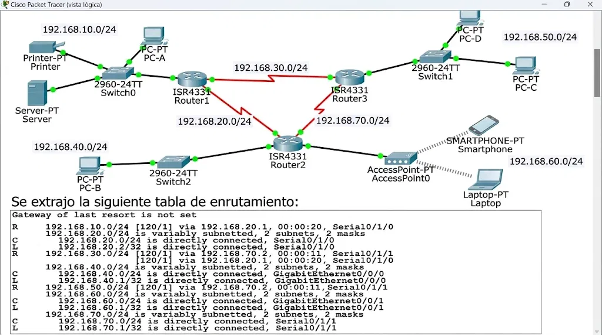

# Auditoría académica independiente de las preguntas OJO Redes 4K1 2026

## Alcance y criterio

Este documento analiza individualmente las seis preguntas que V2 conserva como `AMBIGUA`: posiciones estables 37, 60, 79, 83, 119 y 127. Las respuestas correctas del sitio no se utilizaron como fuente. Se distinguen tres cosas: lo que enseña el material de cátedra, lo que exige la especificación técnica y lo que se puede leer en el recurso actual. Ninguna sección crea una clave puntuable.

Las posiciones corresponden al orden del JSON, no al orden aleatorio de una sesión. Los enunciados y alternativas que siguen se copian literalmente de `preguntas-sin-resolver.json`; las imágenes se vinculan desde `assets/` y se describen según lo que se ve en ellas.

## Resumen comparativo

| Pregunta | Tema | Problema principal | Alternativas defendibles | Evidencia faltante |
|---:|---|---|---|---|
| 37 | TCP SYN+ACK | La pregunta exige dos respuestas, pero solo una es inequívoca según el handshake estricto. | 1 (lectura simplificada de cátedra), 4 | Tercer ACK y criterio de cátedra para «acepta». |
| 60 | Netstat | TCP/23 y UDP/53 son convencionales, pero no prueban qué aplicaciones están corriendo; selección única. | 2 (DNS), 7 (Telnet), con reserva | PID/ejecutable y criterio de selección múltiple. |
| 79 | Netstat | TCP/22, /443 y /8080 admiten varias asociaciones; el proceso no se identifica. | 1 (SSH), 4 (HTTP alternativo), 7 (HTTPS) | PID/ejecutable y aclaración de una o varias respuestas. |
| 83 | SMTP | Ninguna alternativa enumera remitente y destinatarios del sobre. | 4 parcialmente (remitente) | Alternativa completa u original legible. |
| 119 | Routing | La explicación V2 alegaba una duplicación R/C que no aparece en el PNG actual; la imagen y opciones fueron reconstruidas. | 1 según la imagen actual, no como clave histórica | Foto original y selector de respuestas original. |
| 127 | Seguridad | Modificación afecta integridad, pero un hash simple no autentica contra atacante activo. | 1 parcialmente (diagnóstico correcto) | Modelo de integridad y alternativa con MAC/firma/AEAD. |

## Desarrollo exhaustivo

## Pregunta 37 TCP lectura de una captura SYN ACK

### A Identificación

- **Número estable:** 37 (extracción 37).
- **ID exacto:** `q-4e90e92ad7fb323f76cee91952bb22ddb463b606e49c5226c8235b32695944e1`.
- **Tema:** TCP: lectura de una captura SYN+ACK.
- **Tipo:** `multiple`.
- **Respuestas solicitadas:** 2.
- **Estado académico:** `AMBIGUA`; no tiene clave puntuable.
- **Confianza registrada:** MEDIA (respecto de la decisión de mantenerla pendiente, no de la fidelidad histórica del examen).

### B Enunciado original completo

> ¿Cuáles de las siguientes afirmaciones son correctas a partir de la captura de Wireshark de la imagen? (seleccione dos opciones)

### C Todas las alternativas originales

- **ID `option-1`** — El servidor web acepta la conexión e inicia un nuevo socket hacia la PC
- **ID `option-2`** — El servidor va a finalizar la conexión
- **ID `option-3`** — Es un segmento destinado a un servidor HTTPS
- **ID `option-4`** — El servidor le informa a la PC su MSS y su escalado de ventana
- **ID `option-5`** — El servidor web recibió correctamente datos de la PC hasta el byte 65534
- **ID `option-6`** — Una PC desea iniciar una conexión con un servidor web

### D Evidencia de la consigna

El recurso muestra un segmento TCP de origen 443 y destino 52086, flags SYN y ACK, longitud de segmento 0, ventana 65535 y opciones MSS y Window Scale. Los campos de secuencia/acknowledgment raw aparecen vacíos u ocultos. No se ve el tercer ACK de la PC.

**Procedencia y estado de reconstrucción:** Imagen descargada como recurso original del cuestionario (`sourceKind=downloaded_original`), URL registrada: `https://cuestionario-redes.vercel.app/imagenes/captura-wireshark-syn-ack-p3.png`. Es una captura técnica incluida en el banco, no una fotografía independiente del examen. La revisión V2 no halló una foto original que pruebe la fidelidad histórica.

- **Ruta exacta:** `assets/image-55e91291c9b4c2c62ca9ed43.png`.
- **SHA-256:** `55e91291c9b4c2c62ca9ed431c7d08f4a4b08f261bf5403a042d17c3e7450111`.
- **URL de origen registrada:** https://cuestionario-redes.vercel.app/imagenes/captura-wireshark-syn-ack-p3.png.
- **Imagen:** 

### E Análisis individual de alternativas

#### Opción 1

**Texto literal:** El servidor web acepta la conexión e inicia un nuevo socket hacia la PC

**Concepto que expresa:** Respuesta del servidor en el three-way handshake.

**Evidencia a favor:** La filmina de la cátedra describe al servidor como quien acepta y abre el socket inverso al enviar SYN+ACK [1].

**Evidencia en contra / límite:** La especificación TCP muestra que el servidor aún espera el ACK final; el SYN+ACK no prueba por sí solo el estado ESTABLISHED [2].

**Fuente(s):** [1], [2].

**Conclusión provisional:** DEFENDIBLE PERO DISCUTIBLE.

#### Opción 2

**Texto literal:** El servidor va a finalizar la conexión

**Concepto que expresa:** Cierre de la conexión TCP.

**Evidencia a favor:** No hay evidencia a favor en los flags visibles.

**Evidencia en contra / límite:** La captura muestra SYN+ACK y no FIN; no describe un cierre [2].

**Fuente(s):** [1], [2].

**Conclusión provisional:** INCORRECTA SEGÚN LA EVIDENCIA.

#### Opción 3

**Texto literal:** Es un segmento destinado a un servidor HTTPS

**Concepto que expresa:** Dirección del segmento hacia el servicio HTTPS.

**Evidencia a favor:** El puerto 443 está asociado convencionalmente a HTTPS.

**Evidencia en contra / límite:** 443 es el puerto de origen y el destino es 52086; el segmento sale del servidor hacia el cliente, no se dirige al servidor HTTPS [5].

**Fuente(s):** [1], [2].

**Conclusión provisional:** INCORRECTA SEGÚN LA EVIDENCIA.

#### Opción 4

**Texto literal:** El servidor le informa a la PC su MSS y su escalado de ventana

**Concepto que expresa:** Opciones anunciadas durante la negociación TCP.

**Evidencia a favor:** La captura enumera MSS y Window Scale en el segmento SYN+ACK [1, 2].

**Evidencia en contra / límite:** Ninguna contradicción en los datos visibles; sí falta la foto original del examen para confirmar fidelidad histórica.

**Fuente(s):** [1], [2].

**Conclusión provisional:** CORRECTA SEGÚN LA EVIDENCIA.

#### Opción 5

**Texto literal:** El servidor web recibió correctamente datos de la PC hasta el byte 65534

**Concepto que expresa:** ACK acumulativo hasta un número de byte.

**Evidencia a favor:** La captura muestra ventana anunciada 65535.

**Evidencia en contra / límite:** 65535 es el tamaño de ventana, no un acknowledgment; el segmento tiene longitud 0 y no acredita recepción de datos hasta ese byte [2].

**Fuente(s):** [1], [2].

**Conclusión provisional:** INCORRECTA SEGÚN LA EVIDENCIA.

#### Opción 6

**Texto literal:** Una PC desea iniciar una conexión con un servidor web

**Concepto que expresa:** Solicitud de apertura iniciada por la PC.

**Evidencia a favor:** Una PC inició previamente el intercambio.

**Evidencia en contra / límite:** La trama visible es SYN+ACK con origen 443; es la respuesta del servidor, no el SYN inicial de la PC [2].

**Fuente(s):** [1], [2].

**Conclusión provisional:** INCORRECTA SEGÚN LA EVIDENCIA.

### F Motivo exacto del OJO

**¿Por qué no podemos marcar una respuesta correcta con seguridad?** La captura demuestra que el servidor respondió al SYN con SYN+ACK y anunció MSS/Window Scale. La alternativa 1 depende de si «acepta la conexión e inicia un nuevo socket» se usa coloquialmente para describir esa respuesta o si afirma que la conexión ya quedó establecida. El handshake requiere también el ACK final de la PC; el segmento mostrado no prueba que ese intercambio haya ocurrido. Como la pregunta exige dos selecciones, la teoría estricta deja una sola alternativa inequívoca.

### G Interpretaciones posibles

Hipótesis docente: la filmina llama a la respuesta SYN+ACK «acepta la conexión y solicita la apertura de otro socket», por lo que probablemente pretendía las alternativas 1 y 4. Teoría estricta: el SYN+ACK acusa recibo y deja al extremo pasivo esperando el ACK final; no equivale por sí solo a un handshake completado. Evidencia disponible: confirma únicamente la alternativa 4 de manera inequívoca; la imagen no contiene el tercer segmento.

### H Fuentes bibliográficas

- [1] Filminas UTN FRC, `F:\Facundo - Facultad\4to año\REDES\Tercer parcial\Filminas\3 - 01 - RRD - Unidad 5 - Capa de transporte.pdf`, visor pp. 24–25. Presenta SYN, SYN+ACK, ACK final, opciones TCP y el three-way handshake.
- [2] IETF, RFC 9293, *Transmission Control Protocol*, §3.5 (three-way handshake) y §3.10 (máquina de estados): https://www.rfc-editor.org/rfc/rfc9293.html

### I Evidencia necesaria para resolverla

- La captura completa del handshake, incluido el ACK final de la PC.
- Una aclaración de la cátedra sobre si «acepta la conexión» describe la respuesta SYN+ACK o el estado ESTABLISHED.
- La fotografía original del examen, si se quiere confirmar que la captura y la redacción no fueron alteradas.

### J Propuesta para discutir

**Pregunta concreta para nuestra revisión:** ¿La alternativa 1 debe aceptarse como abreviatura docente de la respuesta SYN+ACK, o debe rechazarse porque el servidor aún no completó el handshake?

**Decisión que falta tomar:** Determinar si la simplificación de la filmina basta para puntuar la alternativa 1 junto con la 4.

**Recomendación técnica:** Mantenerla sin puntuar hasta confirmar la interpretación docente o disponer del tercer ACK; no revelar una respuesta en JoyaCards.

---

## Pregunta 60 Netstat sockets en escucha y puertos convencionales

### A Identificación

- **Número estable:** 60 (extracción 60).
- **ID exacto:** `q-c2f920289cc283442fc3da7767aeb2bc58ab211d2a8776260dff04def1ee1459`.
- **Tema:** Netstat: sockets en escucha y puertos convencionales.
- **Tipo:** `single`.
- **Respuestas solicitadas:** 1.
- **Estado académico:** `AMBIGUA`; no tiene clave puntuable.
- **Confianza registrada:** MEDIA (respecto de la decisión de mantenerla pendiente, no de la fidelidad histórica del examen).

### B Enunciado original completo

> La ejecución de un comando nos permite ver los puertos de los servicios que funcionan en el equipo. ¿Qué servicios puede asegurar que están corriendo en el servidor?

### C Todas las alternativas originales

- **ID `option-1`** — SSH
- **ID `option-2`** — DNS
- **ID `option-3`** — HTTPS
- **ID `option-4`** — DHCP
- **ID `option-5`** — HTTP
- **ID `option-6`** — FTP
- **ID `option-7`** — Telnet

### D Evidencia de la consigna

La imagen enumera `tcp 0.0.0.0:9999 ... LISTEN`, `tcp 0.0.0.0:23 ... LISTEN` y `udp 0.0.0.0:53`. Las direcciones externas son comodín. La salida no incluye nombre de proceso, PID ni ejecutable.

**Procedencia y estado de reconstrucción:** El PNG está registrado como descargado del cuestionario (`https://cuestionario-redes.vercel.app/imagenes/netstat-telnet-dns-4k1.png`), pero `sourceNotes` dice que la imagen fue recreada a partir de una reconstrucción de la pregunta. No es una fotografía original independiente del examen.

- **Ruta exacta:** `assets/image-43a7851536808316264f8bea.png`.
- **SHA-256:** `43a7851536808316264f8bea9a0b2805be355b99605cffb1cbce882eaad1490d`.
- **URL de origen registrada:** https://cuestionario-redes.vercel.app/imagenes/netstat-telnet-dns-4k1.png.
- **Imagen:** 

### E Análisis individual de alternativas

#### Opción 1

**Texto literal:** SSH

**Concepto que expresa:** SSH, convencionalmente TCP/22.

**Evidencia a favor:** El puerto 22 suele asociarse a SSH [5].

**Evidencia en contra / límite:** No aparece un listener TCP/22; y en cualquier caso el puerto no identifica por sí solo el proceso [4, 5].

**Fuente(s):** [3], [4], [5].

**Conclusión provisional:** INCORRECTA SEGÚN LA EVIDENCIA.

#### Opción 2

**Texto literal:** DNS

**Concepto que expresa:** DNS, convencionalmente UDP/53.

**Evidencia a favor:** La salida muestra un socket UDP local en el puerto 53, convencional para DNS [3, 5].

**Evidencia en contra / límite:** No se ve el ejecutable/proceso; otro programa puede enlazarse al puerto y la captura también permite asociar TCP/23 a Telnet [4, 5].

**Fuente(s):** [3], [4], [5].

**Conclusión provisional:** DEFENDIBLE PERO DISCUTIBLE.

#### Opción 3

**Texto literal:** HTTPS

**Concepto que expresa:** HTTPS, convencionalmente TCP/443.

**Evidencia a favor:** 443 suele asociarse a HTTPS [5].

**Evidencia en contra / límite:** No aparece un listener TCP/443 [4].

**Fuente(s):** [3], [4], [5].

**Conclusión provisional:** INCORRECTA SEGÚN LA EVIDENCIA.

#### Opción 4

**Texto literal:** DHCP

**Concepto que expresa:** DHCP, convencionalmente UDP/67–68.

**Evidencia a favor:** DHCP utiliza los puertos UDP 67/68 [3, 5].

**Evidencia en contra / límite:** No aparece ningún socket en esos puertos [4].

**Fuente(s):** [3], [4], [5].

**Conclusión provisional:** INCORRECTA SEGÚN LA EVIDENCIA.

#### Opción 5

**Texto literal:** HTTP

**Concepto que expresa:** HTTP, convencionalmente TCP/80.

**Evidencia a favor:** 80 suele asociarse a HTTP [3, 5].

**Evidencia en contra / límite:** No aparece un listener TCP/80 [4].

**Fuente(s):** [3], [4], [5].

**Conclusión provisional:** INCORRECTA SEGÚN LA EVIDENCIA.

#### Opción 6

**Texto literal:** FTP

**Concepto que expresa:** FTP, convencionalmente TCP/20–21.

**Evidencia a favor:** FTP clásico usa los puertos 20/21 en su modelo de referencia [3, 5].

**Evidencia en contra / límite:** No aparece un listener TCP/20 o TCP/21 [4].

**Fuente(s):** [3], [4], [5].

**Conclusión provisional:** INCORRECTA SEGÚN LA EVIDENCIA.

#### Opción 7

**Texto literal:** Telnet

**Concepto que expresa:** Telnet, convencionalmente TCP/23.

**Evidencia a favor:** La imagen muestra TCP/23 en LISTEN y ese puerto está asignado convencionalmente a Telnet [3, 5].

**Evidencia en contra / límite:** La salida no muestra proceso/ejecutable y también muestra UDP/53, por lo que no permite asegurar que Telnet sea la aplicación [4, 5].

**Fuente(s):** [3], [4], [5].

**Conclusión provisional:** DEFENDIBLE PERO DISCUTIBLE.

### F Motivo exacto del OJO

**¿Por qué no podemos marcar una respuesta correcta con seguridad?** El puerto 23/TCP suele asociarse a Telnet y 53/UDP a DNS, pero un socket en escucha prueba que existe un socket enlazado al puerto, no qué aplicación o servicio lo abrió. La salida no muestra `-b`, `-o` ni información de proceso. Además, dos puertos convencionales ofrecen dos asociaciones plausibles en una pregunta configurada como única; el puerto 9999 agrega un listener que las opciones no identifican.

### G Interpretaciones posibles

Hipótesis docente: identificar servicios por puertos conocidos y seleccionar Telnet o DNS. Teoría estricta: los números de puerto son convenciones/registraciones; no identifican la aplicación que realmente abrió el socket. Evidencia disponible: confirma listeners TCP en 9999 y 23 y un socket UDP en 53, pero no identifica procesos.

### H Fuentes bibliográficas

- [3] Filminas UTN FRC, `F:\Facundo - Facultad\4to año\REDES\Tercer parcial\Filminas\3 - 01 - RRD - Unidad 5 - Capa de transporte.pdf`, visor pp. 31–33. La p. 33 define LISTEN como espera de conexiones entrantes; la p. 31 enumera servicios/puertos convencionales.
- [4] Microsoft Learn, `netstat`: https://learn.microsoft.com/en-us/windows-server/administration/windows-commands/netstat. Describe puertos en escucha; el modificador `-b` muestra el ejecutable que creó la conexión o listener.
- [5] IANA, *Service Name and Transport Protocol Port Number Registry*: https://www.iana.org/assignments/service-names-port-numbers/service-names-port-numbers.xhtml. Incluye asignaciones 22/SSH, 23/Telnet, 53/DNS y 443/HTTPS; advierte que una asignación no prueba que el tráfico corresponda a esa aplicación.

### I Evidencia necesaria para resolverla

- La salida de `netstat -b` o una asociación PID→ejecutable que identifique procesos [4].
- Una indicación de que se aceptan varias respuestas o un dato de servicio/proceso que descarte DNS o Telnet.
- La captura original no reconstruida del examen para validar el contenido histórico.

### J Propuesta para discutir

**Pregunta concreta para nuestra revisión:** ¿El ejercicio evalúa la asociación convencional entre puerto y servicio, o pide demostrar qué procesos están ejecutándose?

**Decisión que falta tomar:** Acordar si un puerto conocido basta para llamar al servicio «corriendo» y cómo resolver la contradicción de opción única.

**Recomendación técnica:** Mantenerla sin puntuar; si se conserva como práctica, reformular la consigna como «¿qué servicios suelen asociarse?» o mostrar el proceso asociado.

---

## Pregunta 79 Netstat varios listeners y asociación de servicios

### A Identificación

- **Número estable:** 79 (extracción 79).
- **ID exacto:** `q-bc25ccc6854ea5211b58b91767fb5c64184c68ecefb1cfc612647f7a8b14b7cc`.
- **Tema:** Netstat: varios listeners y asociación de servicios.
- **Tipo:** `single`.
- **Respuestas solicitadas:** 1.
- **Estado académico:** `AMBIGUA`; no tiene clave puntuable.
- **Confianza registrada:** MEDIA (respecto de la decisión de mantenerla pendiente, no de la fidelidad histórica del examen).

### B Enunciado original completo

> La ejecución de un comando nos permite ver los puertos de los servicios que funcionan en el equipo. ¿Qué servicios puede asegurar que están corriendo en el servidor?

### C Todas las alternativas originales

- **ID `option-1`** — SSH
- **ID `option-2`** — DNS
- **ID `option-3`** — DHCP
- **ID `option-4`** — HTTP
- **ID `option-5`** — Telnet
- **ID `option-6`** — FTP
- **ID `option-7`** — HTTPS

### D Evidencia de la consigna

La imagen muestra tres listeners: TCP `0.0.0.0:22`, `0.0.0.0:443` y `0.0.0.0:8080`, todos con estado LISTEN y dirección externa comodín. No muestra nombre de proceso, PID ni ejecutable.

**Procedencia y estado de reconstrucción:** El PNG es el recurso servido por el sitio (`https://cuestionario-redes.vercel.app/imagenes/netstat-puertos-escucha-4k1.png`). Figura como descargado original del banco y no tiene una nota explícita de reconstrucción; aun así, no se encontró una fotografía independiente del examen que pruebe fidelidad histórica.

- **Ruta exacta:** `assets/image-2ce63dd5cad3d702e14de445.png`.
- **SHA-256:** `2ce63dd5cad3d702e14de445aea4aa59247712f226aba95b8d29ae0e87b99168`.
- **URL de origen registrada:** https://cuestionario-redes.vercel.app/imagenes/netstat-puertos-escucha-4k1.png.
- **Imagen:** 

### E Análisis individual de alternativas

#### Opción 1

**Texto literal:** SSH

**Concepto que expresa:** SSH, servicio convencional en TCP/22.

**Evidencia a favor:** TCP/22 está registrado/convencionalmente asociado a SSH [5].

**Evidencia en contra / límite:** Un listener no prueba que el ejecutable sea SSH; además aparecen otros puertos convencionales [4, 5].

**Fuente(s):** [3], [4], [5].

**Conclusión provisional:** DEFENDIBLE PERO DISCUTIBLE.

#### Opción 2

**Texto literal:** DNS

**Concepto que expresa:** DNS, servicio habitual en UDP/53.

**Evidencia a favor:** DNS usa 53, normalmente UDP para consultas ordinarias [3, 5].

**Evidencia en contra / límite:** La captura muestra TCP/22, TCP/443 y TCP/8080, no UDP/53 [4].

**Fuente(s):** [3], [4], [5].

**Conclusión provisional:** INCORRECTA SEGÚN LA EVIDENCIA.

#### Opción 3

**Texto literal:** DHCP

**Concepto que expresa:** DHCP, servicio convencional en UDP/67–68.

**Evidencia a favor:** DHCP usa UDP/67–68 [3, 5].

**Evidencia en contra / límite:** No aparece ninguno de esos puertos [4].

**Fuente(s):** [3], [4], [5].

**Conclusión provisional:** INCORRECTA SEGÚN LA EVIDENCIA.

#### Opción 4

**Texto literal:** HTTP

**Concepto que expresa:** HTTP en puerto alternativo TCP/8080.

**Evidencia a favor:** El listener TCP/8080 puede alojar HTTP alternativo, uso extendido en aplicaciones web [5].

**Evidencia en contra / límite:** 8080 no demuestra HTTP ni qué proceso escucha; un servicio arbitrario puede enlazarse allí [4, 5].

**Fuente(s):** [3], [4], [5].

**Conclusión provisional:** DEFENDIBLE PERO DISCUTIBLE.

#### Opción 5

**Texto literal:** Telnet

**Concepto que expresa:** FTP, servicio convencional TCP/20–21.

**Evidencia a favor:** FTP clásico usa 20/21 [3, 5].

**Evidencia en contra / límite:** La captura no muestra esos puertos [4].

**Fuente(s):** [3], [4], [5].

**Conclusión provisional:** INCORRECTA SEGÚN LA EVIDENCIA.

#### Opción 6

**Texto literal:** FTP

**Concepto que expresa:** Telnet, servicio convencional TCP/23.

**Evidencia a favor:** TCP/23 es el puerto asignado a Telnet [5].

**Evidencia en contra / límite:** La captura no muestra TCP/23 [4].

**Fuente(s):** [3], [4], [5].

**Conclusión provisional:** INCORRECTA SEGÚN LA EVIDENCIA.

#### Opción 7

**Texto literal:** HTTPS

**Concepto que expresa:** HTTPS, servicio convencional TCP/443.

**Evidencia a favor:** TCP/443 está asociado convencionalmente con HTTPS [5].

**Evidencia en contra / límite:** El estado LISTEN no identifica el ejecutable ni demuestra que el servicio sea HTTPS; otros listeners también admiten asociaciones plausibles [4, 5].

**Fuente(s):** [3], [4], [5].

**Conclusión provisional:** DEFENDIBLE PERO DISCUTIBLE.

### F Motivo exacto del OJO

**¿Por qué no podemos marcar una respuesta correcta con seguridad?** TCP/22 suele asociarse a SSH y TCP/443 a HTTPS. TCP/8080 se usa con frecuencia para HTTP alternativo, pero puede alojar otros servicios. `netstat` en esta forma informa sockets/puertos y estado; no identifica qué aplicación los abrió. La pregunta pide una respuesta única aunque la captura tiene varias asociaciones convencionales plausibles.

### G Interpretaciones posibles

Hipótesis docente: elegir una asociación de puerto convencional, posiblemente SSH o HTTPS. Teoría estricta: un listener en un puerto registrado no demuestra por sí solo que corra el servicio asignado; la opción HTTP en 8080 tampoco es segura sin el proceso. Evidencia disponible: tres sockets TCP en escucha, sin proceso asociado.

### H Fuentes bibliográficas

- [3] Filminas UTN FRC, `F:\Facundo - Facultad\4to año\REDES\Tercer parcial\Filminas\3 - 01 - RRD - Unidad 5 - Capa de transporte.pdf`, visor pp. 31–33. La p. 33 define LISTEN como espera de conexiones entrantes; la p. 31 enumera servicios/puertos convencionales.
- [4] Microsoft Learn, `netstat`: https://learn.microsoft.com/en-us/windows-server/administration/windows-commands/netstat. Describe puertos en escucha; el modificador `-b` muestra el ejecutable que creó la conexión o listener.
- [5] IANA, *Service Name and Transport Protocol Port Number Registry*: https://www.iana.org/assignments/service-names-port-numbers/service-names-port-numbers.xhtml. Incluye asignaciones 22/SSH, 23/Telnet, 53/DNS y 443/HTTPS; advierte que una asignación no prueba que el tráfico corresponda a esa aplicación.

### I Evidencia necesaria para resolverla

- La salida `netstat -b` o datos PID/proceso para identificar ejecutables [4].
- Una consigna de selección múltiple o un criterio que descarte dos de los tres listeners.
- La fotografía original del examen si se busca validar que la imagen y las alternativas coincidan con el parcial.

### J Propuesta para discutir

**Pregunta concreta para nuestra revisión:** ¿Debe aceptarse la asociación convencional de los puertos (22, 443 y 8080), o «puede asegurar» requiere identificar el proceso real?

**Decisión que falta tomar:** Definir el alcance de «servicios que funcionan» y si se esperaba una asociación de puerto o evidencia del proceso.

**Recomendación técnica:** Mantenerla sin puntuar y reescribir el ítem para pedir la asociación probable o añadir PID/ejecutable y selección múltiple si corresponde.

---

## Pregunta 83 SMTP envoltura de transporte versus encabezado y cuerpo

### A Identificación

- **Número estable:** 83 (extracción 83).
- **ID exacto:** `q-ad81b98133518664126342919f01b3763cff2e9dfde234dc14623fe4c1eb8476`.
- **Tema:** SMTP: envoltura de transporte versus encabezado y cuerpo.
- **Tipo:** `single`.
- **Respuestas solicitadas:** 1.
- **Estado académico:** `AMBIGUA`; no tiene clave puntuable.
- **Confianza registrada:** ALTA (respecto de la decisión de mantenerla pendiente, no de la fidelidad histórica del examen).

### B Enunciado original completo

> ¿Qué contiene la envoltura de un mensaje SMTP?

### C Todas las alternativas originales

- **ID `option-1`** — Asunto y cuerpo del mensaje
- **ID `option-2`** — Prioridad y nivel de seguridad
- **ID `option-3`** — Versión de POP y versión de SMTP
- **ID `option-4`** — Remitente y versión de SMTP

### D Evidencia de la consigna

No hay imagen asociada. La evidencia disponible es el enunciado literal y cuatro alternativas. La pregunta está configurada como opción única.

**Procedencia y estado de reconstrucción:** No existe referencia visual en el JSON de extracción para esta pregunta. Se analizan el texto transcrito y las alternativas completas; no se infiere una captura ausente.

- **Imagen:** no hay una referencia de imagen asociada en el JSON de extracción.

### E Análisis individual de alternativas

#### Opción 1

**Texto literal:** Asunto y cuerpo del mensaje

**Concepto que expresa:** Campos de asunto y cuerpo del mensaje.

**Evidencia a favor:** Asunto y cuerpo son partes del mensaje/contenido que transporta SMTP [6].

**Evidencia en contra / límite:** No describen los comandos MAIL FROM y RCPT TO que forman el sobre de transporte [7].

**Fuente(s):** [6], [7].

**Conclusión provisional:** INCORRECTA SEGÚN LA EVIDENCIA.

#### Opción 2

**Texto literal:** Prioridad y nivel de seguridad

**Concepto que expresa:** Prioridad y nivel de seguridad.

**Evidencia a favor:** Pueden aparecer como datos/atributos de mensaje en ciertos formatos.

**Evidencia en contra / límite:** No son los campos del sobre SMTP requeridos para encaminar la transacción [7].

**Fuente(s):** [6], [7].

**Conclusión provisional:** INCORRECTA SEGÚN LA EVIDENCIA.

#### Opción 3

**Texto literal:** Versión de POP y versión de SMTP

**Concepto que expresa:** Versión de POP y versión de SMTP.

**Evidencia a favor:** Menciona dos protocolos de correo.

**Evidencia en contra / límite:** El sobre identifica reverse-path y forward-path; no consiste en versiones de protocolos [7].

**Fuente(s):** [6], [7].

**Conclusión provisional:** INCORRECTA SEGÚN LA EVIDENCIA.

#### Opción 4

**Texto literal:** Remitente y versión de SMTP

**Concepto que expresa:** Remitente y versión de SMTP.

**Evidencia a favor:** «Remitente» puede corresponder al reverse-path de MAIL FROM [7].

**Evidencia en contra / límite:** La versión de SMTP no integra el sobre y faltan los destinatarios RCPT TO; por eso no es una respuesta completa [7].

**Fuente(s):** [6], [7].

**Conclusión provisional:** DEFENDIBLE PERO DISCUTIBLE.

### F Motivo exacto del OJO

**¿Por qué no podemos marcar una respuesta correcta con seguridad?** El sobre (envelope) SMTP de la transacción identifica un remitente con MAIL FROM y uno o más destinatarios con RCPT TO. Ninguna alternativa incluye ambos. La opción 4 menciona remitente, pero añade «versión de SMTP» —que no es componente del sobre— y omite destinatarios. Asunto/cuerpo pertenecen al contenido del mensaje; prioridades o versiones de POP/SMTP no completan el sobre.

### G Interpretaciones posibles

Hipótesis docente: la cátedra podría haber querido que se responda «remitente» o diferenciar sobre de cuerpo, o el enunciado/opción pudo perder una parte en la transcripción. Teoría estricta: hacen falta dirección de retorno y destinatarios de la transacción SMTP [7]. Evidencia disponible: ninguna opción ofrece esa pareja completa.

### H Fuentes bibliográficas

- [6] Filminas UTN FRC, `F:\Facundo - Facultad\4to año\REDES\Tercer parcial\Filminas\3 - 02 - RRD - Unidad 5 - Capa de APLICACIÓN.pdf`, visor pp. 30–32. Separa envoltura, encabezado y cuerpo; la envoltura lleva datos para la transferencia/MTA.
- [7] IETF, RFC 5321, *Simple Mail Transfer Protocol*, §3.3 y §§4.1.1.2–4.1.1.3: `MAIL FROM` y `RCPT TO`; https://www.rfc-editor.org/rfc/rfc5321.html

### I Evidencia necesaria para resolverla

- La opción original completa, si se perdió una frase durante la extracción.
- Una aclaración de la cátedra sobre si «envoltura» se usó de forma abreviada para un solo campo.
- La fotografía original del enunciado y sus alternativas.

### J Propuesta para discutir

**Pregunta concreta para nuestra revisión:** ¿La opción «remitente y versión SMTP» pretendía decir «remitente y destinatario», o realmente estaba incompleta en el examen?

**Decisión que falta tomar:** Decidir si existe una opción original perdida o si el ítem debe mantenerse definitivamente sin respuesta.

**Recomendación técnica:** Mantenerla sin puntuar; corregir la alternativa para que incluya MAIL FROM y RCPT TO si se prepara una versión nueva.

---

## Pregunta 119 Routing lectura histórica de una tabla reconstruida

### A Identificación

- **Número estable:** 119 (extracción 119).
- **ID exacto:** `q-d464c1c8de0b704fc84ce85c760f824c1abb241eb352cb0420a8ef64dd2b4a43`.
- **Tema:** Routing: lectura histórica de una tabla reconstruida.
- **Tipo:** `single`.
- **Respuestas solicitadas:** 1.
- **Estado académico:** `AMBIGUA`; no tiene clave puntuable.
- **Confianza registrada:** ALTA (respecto de la decisión de mantenerla pendiente, no de la fidelidad histórica del examen).

### B Enunciado original completo

> Observe la topología y la tabla de enrutamiento de la imagen. ¿Cómo aprendió este router la red 192.168.70.0/24?

### C Todas las alternativas originales

- **ID `option-1`** — Está directamente conectada
- **ID `option-2`** — Mediante una ruta estática
- **ID `option-3`** — Mediante el protocolo RIP
- **ID `option-4`** — Mediante el protocolo OSPF

### D Evidencia de la consigna

En la imagen actual, la tabla muestra `C 192.168.70.0/24 is directly connected, Serial0/1/1` y `L 192.168.70.1/32 is directly connected, Serial0/1/1`. No se observa una ruta R para el prefijo 192.168.70.0/24. La ruta R cercana visible es `192.168.50.0/24 [120/1] via 192.168.70.2`; otras filas R corresponden a 10.0/24 y 30.0/24.

**Procedencia y estado de reconstrucción:** PNG descargado del banco como `https://cuestionario-redes.vercel.app/imagenes/topologia-tabla-ruteo-4k1.png`; SHA-256 `42a2abb1e63652c10014ce21e81588a799bdc138bd69fac91c92b98485f61fd0`. La nota de extracción indica que las opciones no eran visibles en el parcial y fueron reconstruidas, y que la imagen se mejoró con IA. No se halló una fotografía independiente del examen.

- **Ruta exacta:** `assets/image-42a2abb1e63652c10014ce21.png`.
- **SHA-256:** `42a2abb1e63652c10014ce21e81588a799bdc138bd69fac91c92b98485f61fd0`.
- **URL de origen registrada:** https://cuestionario-redes.vercel.app/imagenes/topologia-tabla-ruteo-4k1.png.
- **Imagen:** 

### E Análisis individual de alternativas

#### Opción 1

**Texto literal:** Está directamente conectada

**Concepto que expresa:** Red directamente conectada al router.

**Evidencia a favor:** El PNG visible marca C para `192.168.70.0/24` y L para `192.168.70.1/32` en Serial0/1/1; C representa connected [9].

**Evidencia en contra / límite:** La imagen fue mejorada y la opción fue reconstruida, así que la lectura no acredita el original histórico.

**Fuente(s):** [8], [9].

**Conclusión provisional:** CORRECTA SEGÚN LA EVIDENCIA DE LA RECONSTRUCCIÓN; HISTORIA NO VERIFICABLE.

#### Opción 2

**Texto literal:** Mediante una ruta estática

**Concepto que expresa:** Ruta estática.

**Evidencia a favor:** No hay dato visual que apoye una ruta estática para .70.

**Evidencia en contra / límite:** No se ve código S; la ruta de red visible está rotulada C [9].

**Fuente(s):** [8], [9].

**Conclusión provisional:** INCORRECTA SEGÚN LA EVIDENCIA DISPONIBLE.

#### Opción 3

**Texto literal:** Mediante el protocolo RIP

**Concepto que expresa:** Ruta aprendida por RIP.

**Evidencia a favor:** El código R aparece en otras rutas de la tabla y RIP se asocia a AD 120 [8, 9].

**Evidencia en contra / límite:** No hay fila R para 192.168.70.0/24 en el PNG ampliado. La entrada R visible por 192.168.70.2 corresponde a 192.168.50.0/24 [9].

**Fuente(s):** [8], [9].

**Conclusión provisional:** INCORRECTA SEGÚN LA RECONSTRUCCIÓN; HISTORIA NO VERIFICABLE.

#### Opción 4

**Texto literal:** Mediante el protocolo OSPF

**Concepto que expresa:** Ruta aprendida por OSPF.

**Evidencia a favor:** OSPF aparece como código O en el esquema Cisco [9].

**Evidencia en contra / límite:** No se observa una entrada O para el prefijo .70 ni otra evidencia de OSPF [9].

**Fuente(s):** [8], [9].

**Conclusión provisional:** INCORRECTA SEGÚN LA EVIDENCIA DISPONIBLE.

### F Motivo exacto del OJO

**¿Por qué no podemos marcar una respuesta correcta con seguridad?** El análisis V2 afirmaba que 192.168.70.0/24 aparece a la vez como R y C. Amplié visualmente el PNG: solo se lee C para ese prefijo, además de L 192.168.70.1/32; no hay fila R de .70. La fila RIP cercana anuncia .50/24 vía .70.2, lo que puede haber causado la confusión. Por el diagrama disponible, la opción «directamente conectada» coincide con la reconstrucción. Sin foto del examen ni opciones originales, no puede certificarse que la imagen mejorada represente lo que se evaluó históricamente; la razón original de ambigüedad estaba equivocada y se corrige.

### G Interpretaciones posibles

Hipótesis docente: si el ítem se basó en la tabla hoy visible, probablemente pretendía «directamente conectada» por el código C. Teoría estricta de la tabla mostrada: las rutas C y L son rutas local/conectada; una ruta R tendría código R y menor preferencia frente a una ruta conectada con distancia administrativa 0, frente a RIP 120 [8, 9]. Evidencia disponible: la reconstrucción muestra C/L para .70, no R; la fidelidad del artefacto al original y las opciones originales no se verifican.

### H Fuentes bibliográficas

- [8] Filminas UTN FRC, `F:\Facundo - Facultad\4to año\REDES\Segundo parcial\filminas\2 - 06 - RDD - Unidad 4 - Encaminamiento en Internet.pdf`, visor pp. 8–9. RIP: métrica por saltos, AD 120; conectado/estático comparados por confianza.
- [9] Cisco, *Cisco IOS IP Routing: Protocol-Independent Command Reference*, `show ip route` route codes and default AD: C=connected, S=static, R=RIP; connected AD 0 and RIP AD 120. https://www.cisco.com/c/en/us/td/docs/ios/iproute_pi/command/reference/iri_book/iri_pi1.html and https://www.cisco.com/c/en/us/td/docs/ios/iproute_pi/command/reference/iri_book/iri_pi2.html

### I Evidencia necesaria para resolverla

- Una fotografía original sin mejora de la tabla y del selector de respuestas del examen.
- La lista original de alternativas, que la nota de extracción dice que no pudo verse.
- Si existe, una captura independiente de la página 4K1 antes de la reconstrucción IA.

### J Propuesta para discutir

**Pregunta concreta para nuestra revisión:** Si el PNG actual es lo único que se conserva, ¿alcanza para tratar la alternativa «directamente conectada» como clave del ejercicio de práctica, o debemos mantener la cautela histórica y no puntuar?

**Decisión que falta tomar:** Resolver si se puntúa el escenario dibujado o se mantiene sin puntuar por falta de evidencia de fidelidad histórica; no promover automáticamente la clave.

**Recomendación técnica:** Mantenerla sin puntuar y con OJO según la instrucción del proyecto. La próxima revisión debe partir de la fotografía original; retirar del historial la afirmación errónea de que el PNG muestra R/C duplicado para .70.

---

## Pregunta 127 Seguridad integridad ante un atacante activo

### A Identificación

- **Número estable:** 127 (extracción 127).
- **ID exacto:** `q-96f1748132d556ec2f1315a373676a5e53a184be89347f30dab24877f53ccd79`.
- **Tema:** Seguridad: integridad ante un atacante activo.
- **Tipo:** `single`.
- **Respuestas solicitadas:** 1.
- **Estado académico:** `AMBIGUA`; no tiene clave puntuable.
- **Confianza registrada:** ALTA (respecto de la decisión de mantenerla pendiente, no de la fidelidad histórica del examen).

### B Enunciado original completo

> Una sucursal envía órdenes de pago a casa central por un enlace cifrado. Un atacante no puede leerlas, pero modifica algunos bits y casa central procesa datos distintos. ¿Qué tipo de amenaza ocurrió y qué faltó?

### C Todas las alternativas originales

- **ID `option-1`** — Modificación, ataca la integridad. El cifrado solo da confidencialidad y faltaba un hash para detectar la alteración
- **ID `option-2`** — Interceptación, ataca la confidencialidad. Faltaba una clave más larga
- **ID `option-3`** — Interrupción, ataca la disponibilidad. Faltaba un firewall con estado
- **ID `option-4`** — Invención, ataca la autenticidad. Faltaba cifrar dos veces

### D Evidencia de la consigna

No hay imagen asociada. El enunciado dice que la sucursal envía órdenes de pago cifradas; el atacante no las lee, modifica algunos bits y casa central procesa datos distintos. Se pide identificar amenaza y qué faltó.

**Procedencia y estado de reconstrucción:** El caso se recibe como texto, sin captura o anexo visual. Se confronta con la filmina local sobre integridad/hash y estándares primarios sobre MAC/HMAC y cifrado autenticado.

- **Imagen:** no hay una referencia de imagen asociada en el JSON de extracción.

### E Análisis individual de alternativas

#### Opción 1

**Texto literal:** Modificación, ataca la integridad. El cifrado solo da confidencialidad y faltaba un hash para detectar la alteración

**Concepto que expresa:** Modificación/integridad; hash para detectar alteración.

**Evidencia a favor:** Identifica correctamente modificación e integridad; un hash puede detectar cambios accidentales si el valor de referencia es confiable [10].

**Evidencia en contra / límite:** Ante un atacante activo, un hash sin clave/autenticación puede reemplazarse o recalcularse; no garantiza autenticidad del mensaje [11, 12].

**Fuente(s):** [10], [11], [12], [13].

**Conclusión provisional:** DEFENDIBLE PERO DISCUTIBLE (diagnóstico correcto, solución insuficiente).

#### Opción 2

**Texto literal:** Interceptación, ataca la confidencialidad. Faltaba una clave más larga

**Concepto que expresa:** Interceptación/confidencialidad; una clave más larga.

**Evidencia a favor:** Una clave más fuerte puede apoyar confidencialidad.

**Evidencia en contra / límite:** El escenario dice que el atacante no leyó los datos; el daño fue modificar bits. La longitud de clave no aporta por sí sola autenticación/integridad [11, 12].

**Fuente(s):** [10], [11], [12], [13].

**Conclusión provisional:** INCORRECTA SEGÚN LA EVIDENCIA.

#### Opción 3

**Texto literal:** Interrupción, ataca la disponibilidad. Faltaba un firewall con estado

**Concepto que expresa:** Interrupción/disponibilidad; firewall con estado.

**Evidencia a favor:** Un firewall con estado puede controlar flujos en ciertos escenarios.

**Evidencia en contra / límite:** No se describe una interrupción del servicio; se procesaron datos modificados. Un firewall no autentica el contenido del mensaje por sí solo [11, 12].

**Fuente(s):** [10], [11], [12], [13].

**Conclusión provisional:** INCORRECTA SEGÚN LA EVIDENCIA.

#### Opción 4

**Texto literal:** Invención, ataca la autenticidad. Faltaba cifrar dos veces

**Concepto que expresa:** Invención/autenticidad; cifrar dos veces.

**Evidencia a favor:** La autenticidad es un servicio de seguridad relacionado.

**Evidencia en contra / límite:** El atacante modificó un mensaje existente, no inventó uno; el doble cifrado no equivale a MAC, firma o AEAD [11–13].

**Fuente(s):** [10], [11], [12], [13].

**Conclusión provisional:** INCORRECTA SEGÚN LA EVIDENCIA.

### F Motivo exacto del OJO

**¿Por qué no podemos marcar una respuesta correcta con seguridad?** La amenaza descrita es modificación y afecta integridad. La alternativa 1 identifica correctamente esa amenaza, pero propone un hash simple como protección activa. Un atacante que puede alterar el mensaje puede recalcular un hash no autenticado; el hash por sí solo no prueba quién generó el valor. Para resistir alteración activa hace falta autenticación criptográfica —por ejemplo, MAC/HMAC, firma verificable según el modelo, o cifrado autenticado AEAD— y la pregunta no aporta ninguna de esas opciones completas [11–13]. La filmina relaciona hash con integridad, pero no distingue hash simple de autenticación contra adversario activo [10].

### G Interpretaciones posibles

Hipótesis docente: la filmina puede haber llevado a responder «hash» como mecanismo de integridad [10]. Teoría estricta: la confidencialidad del cifrado no implica autenticidad/integridad; para un atacante activo se requiere una etiqueta autenticada o firma [11–13]. Evidencia disponible: la descripción demuestra modificación; el método exacto de cifrado, ubicación del hash, existencia de clave compartida o autenticación no se especifican.

### H Fuentes bibliográficas

- [10] Filminas UTN FRC, `F:\Facundo - Facultad\4to año\REDES\Tercer parcial\Filminas\3 - 06 - RRD - Unidad 6 - Seguridad.pdf`, visor pp. 16–17. Presenta integridad y hash/digest; no detalla un hash autenticado contra adversario activo.
- [11] IETF, RFC 2104, *HMAC: Keyed-Hashing for Message Authentication*, §1. Explica que el MAC usa una clave secreta compartida para validar mensajes: https://www.rfc-editor.org/rfc/rfc2104.html
- [12] IETF, RFC 5116, *An Interface and Algorithms for Authenticated Encryption*, §1. AE/AEAD brinda confidencialidad y una forma de comprobar integridad y autenticidad: https://www.rfc-editor.org/rfc/rfc5116.html
- [13] NIST, FIPS 186-5, *Digital Signature Standard*, introducción. Firma con clave privada y verificación con la pública correspondiente: https://nvlpubs.nist.gov/nistpubs/FIPS/NIST.FIPS.186-5.pdf

### I Evidencia necesaria para resolverla

- Si el esquema existente era cifrado sin integridad, cifrado con hash interno, MAC separado o AEAD.
- Qué amenaza/servicio quería nombrar la cátedra: detectar errores accidentales o resistir manipulación maliciosa.
- Una alternativa técnicamente suficiente, por ejemplo MAC/HMAC, firma digital o AEAD.

### J Propuesta para discutir

**Pregunta concreta para nuestra revisión:** ¿Debe considerarse correcta la alternativa 1 por identificar modificación/integridad en el marco simplificado de la filmina, o se la rechaza porque un hash no autenticado no protege frente a un atacante activo?

**Decisión que falta tomar:** Decidir si se mantiene como no puntuable o si se reescribe la alternativa con un mecanismo autenticado y una clave/modelo de confianza definidos.

**Recomendación técnica:** Mantenerla sin puntuar y no revelar la alternativa 1 como respuesta. Si se busca evaluar solo la categoría de amenaza, separarla de la pregunta sobre el mecanismo de protección.

---

## Bibliografía consultada

- [1] Filminas UTN FRC, `F:\Facundo - Facultad\4to año\REDES\Tercer parcial\Filminas\3 - 01 - RRD - Unidad 5 - Capa de transporte.pdf`, visor pp. 24–25. Presenta SYN, SYN+ACK, ACK final, opciones TCP y el three-way handshake.
- [2] IETF, RFC 9293, *Transmission Control Protocol*, §3.5 (three-way handshake) y §3.10 (máquina de estados): https://www.rfc-editor.org/rfc/rfc9293.html
- [3] Filminas UTN FRC, `F:\Facundo - Facultad\4to año\REDES\Tercer parcial\Filminas\3 - 01 - RRD - Unidad 5 - Capa de transporte.pdf`, visor pp. 31–33. La p. 33 define LISTEN como espera de conexiones entrantes; la p. 31 enumera servicios/puertos convencionales.
- [4] Microsoft Learn, `netstat`: https://learn.microsoft.com/en-us/windows-server/administration/windows-commands/netstat. Describe puertos en escucha; el modificador `-b` muestra el ejecutable que creó la conexión o listener.
- [5] IANA, *Service Name and Transport Protocol Port Number Registry*: https://www.iana.org/assignments/service-names-port-numbers/service-names-port-numbers.xhtml. Incluye asignaciones 22/SSH, 23/Telnet, 53/DNS y 443/HTTPS; advierte que una asignación no prueba que el tráfico corresponda a esa aplicación.
- [6] Filminas UTN FRC, `F:\Facundo - Facultad\4to año\REDES\Tercer parcial\Filminas\3 - 02 - RRD - Unidad 5 - Capa de APLICACIÓN.pdf`, visor pp. 30–32. Separa envoltura, encabezado y cuerpo; la envoltura lleva datos para la transferencia/MTA.
- [7] IETF, RFC 5321, *Simple Mail Transfer Protocol*, §3.3 y §§4.1.1.2–4.1.1.3: `MAIL FROM` y `RCPT TO`; https://www.rfc-editor.org/rfc/rfc5321.html
- [8] Filminas UTN FRC, `F:\Facundo - Facultad\4to año\REDES\Segundo parcial\filminas\2 - 06 - RDD - Unidad 4 - Encaminamiento en Internet.pdf`, visor pp. 8–9. RIP: métrica por saltos, AD 120; conectado/estático comparados por confianza.
- [9] Cisco, *Cisco IOS IP Routing: Protocol-Independent Command Reference*, `show ip route` route codes and default AD: C=connected, S=static, R=RIP; connected AD 0 and RIP AD 120. https://www.cisco.com/c/en/us/td/docs/ios/iproute_pi/command/reference/iri_book/iri_pi1.html and https://www.cisco.com/c/en/us/td/docs/ios/iproute_pi/command/reference/iri_book/iri_pi2.html
- [10] Filminas UTN FRC, `F:\Facundo - Facultad\4to año\REDES\Tercer parcial\Filminas\3 - 06 - RRD - Unidad 6 - Seguridad.pdf`, visor pp. 16–17. Presenta integridad y hash/digest; no detalla un hash autenticado contra adversario activo.
- [11] IETF, RFC 2104, *HMAC: Keyed-Hashing for Message Authentication*, §1. Explica que el MAC usa una clave secreta compartida para validar mensajes: https://www.rfc-editor.org/rfc/rfc2104.html
- [12] IETF, RFC 5116, *An Interface and Algorithms for Authenticated Encryption*, §1. AE/AEAD brinda confidencialidad y una forma de comprobar integridad y autenticidad: https://www.rfc-editor.org/rfc/rfc5116.html
- [13] NIST, FIPS 186-5, *Digital Signature Standard*, introducción. Firma con clave privada y verificación con la pública correspondiente: https://nvlpubs.nist.gov/nistpubs/FIPS/NIST.FIPS.186-5.pdf

## Evidencia faltante consolidada

- Fotografías originales del examen para las capturas TCP/netstat/routing; los PNGs del sitio no demuestran fidelidad histórica.
- Salida de proceso (`netstat -b` o PID y ejecutable) para las preguntas 60 y 79.
- Captura íntegra de handshake de q37, incluido el tercer ACK.
- Redacción y opciones originales de q83 y q119; en q119 el selector no se conservó.
- Definición explícita del adversario y del mecanismo de integridad en q127, más una opción criptográficamente suficiente.

## Plan sugerido para la revisión conjunta

1. Revisar primero q119 con el PNG ampliado y buscar la fotografía del examen; no repetir la afirmación de una fila R para .70 sin comprobarla visualmente.
2. Acordar si los ítems netstat preguntan por puertos convencionales o por procesos que el comando realmente identifica.
3. Resolver q37 con el handshake TCP de tres vías y el texto exacto de la filmina.
4. Corregir q83 para incluir MAIL FROM y RCPT TO, o confirmar si falta una alternativa original.
5. Separar en q127 la identificación de amenaza de la selección del control criptográfico.

**Estado de esta auditoría:** las seis posiciones continúan sin clave y sin puntuación en V3. La marca OJO se añade al enunciado visible como dato de presentación, sin alterar el enunciado original almacenado.
